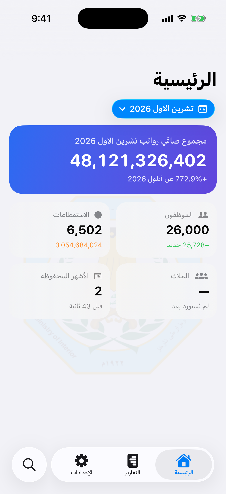
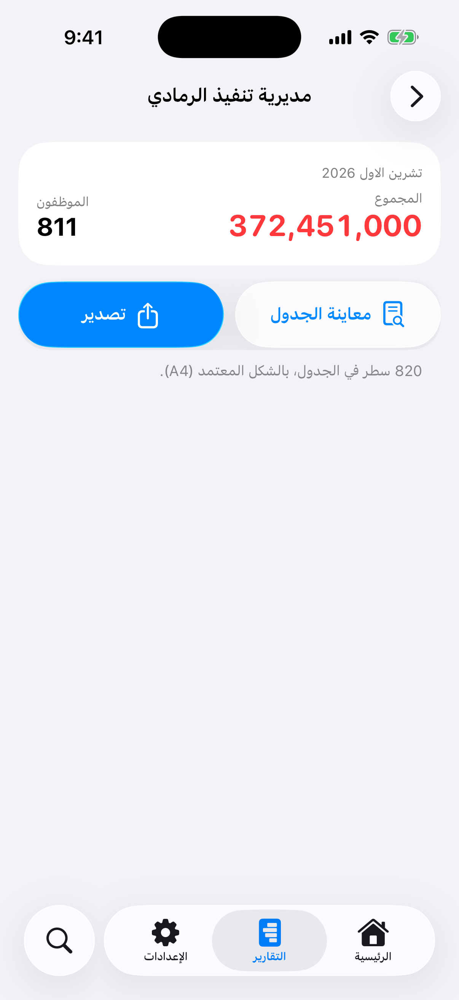
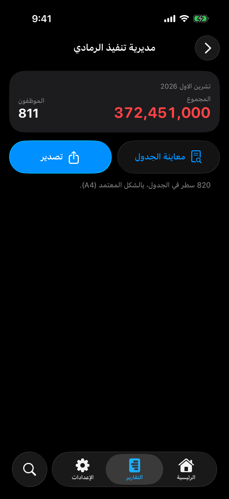

# فحص السلاسة والواجهة — 25–26 تشرين الأول 2026

اختُبرت شيفرة التطبيق عند `025ab36` على iPhone 17 Pro بمحاكي iOS 26.5 وXcode 26.6. أدوات iOS 27 غير متاحة في البيئة الحالية، ولم يُدّع استخدامها.

## الإصلاحات النهائية

- استعادة `TabView` الأصلي: زجاج النظام وحركة الاختيار والتصغير أثناء التمرير، مع البحث المستقل والمشاركة عند عرض القسيمة. أُلغي الشريط المخصص الذي اشتكى منه المالك.
- توحيد رموز المعاينة والتصدير وExcel وPDF، وأزرار التقارير الزجاجية وأيقونات التصدير العلوية.
- استجابة المعاينة والتصدير للضغط أثناء تحميل البيانات، مع عرض تقدّم التجهيز وإظهار الخطأ عند حدوثه. أُعيد الاختبار الذي كشف ضياع الضغط المبكر ونجح.
- تجهيز PDF المعروض فقط وفتحه في الخلفية، وتأجيل صورة القسيمة إلى حين اختيارها.
- إلغاء تحميل الملاك والرواتب بالكامل عند الفتح. البحث يستخدم استعلامات محدودة في الخلفية ودفعات للأسماء وربطًا مجمّعًا وذاكرة نتائج محدودة، ويلغي الطلبات القديمة عند تغيّر النص.
- إضافة فهارس لمفتاح ربط الشخص، وتقليل بيانات الرواتب المقروءة لكشف استقطاع واحد.
- صفحة التقارير تعرض ملخص التدقيق الجاهز دون حساب الشهر كله عند دخولها. بقي التدقيق عند اختياره والتدقيق التلقائي بعد الاستيراد، مع إبطال النتائج القديمة بعد استبدال البيانات.

## الأدلة

- [الفحص النهائي — ناجح](https://github.com/3hasnawi/ios-app/actions/runs/40245726805): ثلاثة اختبارات، صفر إخفاقات وظيفية؛ التنقّل والبحث والعودة والمشاركة والمعاينة والتصدير. سُجل تنبيه بطء واحد أثناء انتظار نتائج البحث بأداة الواجهة.
- [الفحص الشامل للإصلاحات الأولى](https://github.com/3hasnawi/ios-app/actions/runs/40241300723): نسخ واسترجاع 32000 سجل رواتب، و8004 استقطاعات، و42000 سجل ملاك عبر ثلاثة أشهر؛ رفض نسخة تالفة مع بقاء البيانات؛ الكتابة مرتين إلى ملف الاختبار نفسه. كشف هذا التشغيل إخفاق الضغط المبكر على المعاينة؛ أُصلح لاحقًا وأُعيد مساره بنجاح.
- [اختبار إصلاح الضغط المبكر — ناجح](https://github.com/3hasnawi/ios-app/actions/runs/40244026157): ثلاثة اختبارات دون إخفاقات وظيفية.
- [النسخة المرجعية build-31](https://github.com/3hasnawi/ios-app/actions/runs/40240619331).

قياس التنقّل الآلي داخل التطبيق، دون حمل XCUITest:

| المؤشر | المرجع b41087c | النهائي 025ab36 |
|---|---:|---:|
| أول بحث مسجل | 7284 مللي ثانية | 1542 مللي ثانية |
| وسيط أزمنة البحث | 85 مللي ثانية | 100 مللي ثانية |
| أقصى توقّف في فتح نتائج الأشخاص خلال المسار | 411 مللي ثانية | 232 مللي ثانية |

النتائج من تشغيلين منفصلين على آلات المحاكي وليست معيارًا مضبوطًا أو قياسًا على آيفون حقيقي. المرجع يحتوي 32000 راتب عبر ثلاثة أشهر، والفحص النهائي الموجّه 29000 راتب عبر شهرين؛ كلاهما يتضمن 42000 سجل ملاك وهمي. بقيت وقفات قصيرة في التنقّل، ورصد التشغيل النهائي توقّفًا بنحو 2.6 ثانية عند الفتح الأول قبل بدء المسار الآلي. لا تُفسر أزمنة خطوات XCUITest باعتبارها أزمنة استجابة التطبيق وحده؛ الأداة تقرأ شجرة الإتاحة وتضيف حملًا ملحوظًا.

تقارير الفحص النهائي محفوظة في التزام الصور الثابت:
`f6e6ee7242e8bd4cf2f0bcfbb4fc57a1cae0d803`، في فرع `screenshots` (`navigation-report.txt`، `autopilot-report.txt`، `perf-autopilot.txt`، ولقطات الشاشة والفيديو).

لم يُختبر iCloud الحقيقي أو تثبيت النسخة على هاتف المالك في هذه الجلسة. اختبار النسخ التلقائي يستخدم ملفًا محليًا يحاكي الوجهة. كل بيانات الاختبارات والأسماء وهمية.

## لقطات فعلية من المحاكي

